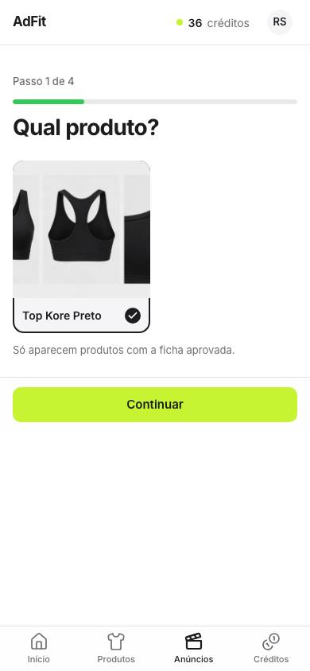

# AdFit

Plataforma web que transforma fotos de uma peça de roupa fitness num vídeo de anúncio de 15 segundos, gerado com IA, pronto para Reels, Stories ou feed.

**Site:** [adfit.com.br](https://adfit.com.br)

<p>
  
  
  
</p>

## Principais funcionalidades

- **Ficha de produto:** a marca sobe fotos da peça como tiver (no cabide, na mesa, vestida) e aprova uma ficha gerada por IA, que serve de referência de fidelidade.
- **Novo anúncio por opções de negócio:** cenário, modalidade esportiva, modelo, estilo e formato (9:16 ou 16:9) — sem prompt e sem jargão de IA.
- **Imagem antes de vídeo:** o roteiro é escrito por IA, cada cena vira uma imagem que o usuário aprova ou pede para refazer, com checagem automática de fidelidade à peça; só então os clipes de vídeo são gerados.
- **Montagem no código:** texto na tela, CTA e logo da marca são sobrepostos na montagem (ffmpeg), nunca gerados pelo modelo.
- **Créditos:** toda ação mostra o custo antes do clique; compra de pacotes de créditos com Stripe Checkout.
- **Login com Google** e acesso por convite; interface em português e inglês.
- Área administrativa para gerir marcas, usuários, créditos e gerações.

## Stack técnica

- **Monorepo** npm workspaces, TypeScript.
- **Web:** Next.js 16 (App Router) em [`apps/web`](apps/web), deploy na Vercel.
- **Banco, autenticação e arquivos:** Supabase (Postgres com RLS, Auth, Storage).
- **IA:** Claude API (Anthropic) para roteiro e checagem de qualidade; API da Higgsfield para imagens e clipes de vídeo.
- **Montagem do vídeo:** `ffmpeg-static` numa função da Vercel, com textos renderizados via `opentype.js`.
- **Pagamentos:** Stripe Checkout e webhooks.
- **E-mail:** Resend (convites).
- **Agendamento:** cron da Vercel e um workflow do GitHub Actions ([`.github/workflows/varredura.yml`](.github/workflows/varredura.yml)) que dispara a varredura de anúncios em andamento.
- **Testes:** pgTAP (banco) e Vitest.

## Como foi construído

O AdFit foi desenvolvido com Claude (Anthropic) a partir de uma especificação no formato SDD:

- [`docs/spec.md`](docs/spec.md) — a fonte única de verdade (cópia idêntica em [`spec.md`](spec.md)).
- [`docs/mudancas-de-escopo.md`](docs/mudancas-de-escopo.md) — as emendas aprovadas depois da spec.
- [`plans/`](plans/) — o plano aprovado de cada épico antes da implementação.
- [`CLAUDE.md`](CLAUDE.md) — regras e convenções para o agente; [`DOCUMENTACAO-TECNICA.md`](DOCUMENTACAO-TECNICA.md) — como está implementado.
- [`docs/design/`](docs/design/) — capturas de todas as telas, em claro e escuro.

Guardrails que existem no repositório:

- **Hooks do Claude Code** em [`.claude/hooks/`](.claude/hooks/), configurados em [`.claude/settings.json`](.claude/settings.json): bloqueiam segredos em código que roda no cliente, edição de migrations já versionadas, edição de prompts versionados (mudança vira nova versão) e edição de testes durante correção de bug; e lembram de rodar os advisors do Supabase.
- **Agente verificador** ([`.claude/agents/verifier.md`](.claude/agents/verifier.md)) e instruções de revisão em [`REVIEW.md`](REVIEW.md).
- **Testes:** pgTAP em [`supabase/tests/`](supabase/tests/) e Vitest no app. `npm run verify` roda typecheck, lint, testes e build, e falha se qualquer um falhar.

## Status

Publicado — no ar em [adfit.com.br](https://adfit.com.br).

## Rodar localmente

Requisitos: Node 22+, Docker (para o Supabase local), Supabase CLI e `jq` (usado pelos hooks de `.claude/hooks/`).

```bash
npm install
supabase start                         # Supabase local
cp .env.example apps/web/.env.local    # preencha com `supabase status -o env` e as demais chaves
npm run seed:admin                     # cria um admin local
npm run dev                            # http://localhost:3000
```

```bash
npm run verify    # typecheck, lint, testes (pgTAP + Vitest) e build
```

Estrutura:

- `apps/web` — o site (Next.js).
- `apps/worker` — esqueleto do worker previsto na spec; não usado, porque a montagem roda numa função da Vercel.
- `supabase/` — migrations, seed e testes pgTAP. Migration versionada nunca se edita: mudança de esquema vira arquivo novo.
- `scripts/` — seed do admin, testes de banco e captura das telas.

Para o fluxo completo de geração (Higgsfield, Claude), pagamentos em modo de teste da Stripe e login, veja [`DOCUMENTACAO-TECNICA.md`](DOCUMENTACAO-TECNICA.md).

## Créditos de terceiros

- A fonte **Inter** ([rsms/inter](https://github.com/rsms/inter)), usada nos textos sobrepostos ao vídeo, está em `apps/web/src/server/video/assets/` sob a SIL Open Font License 1.1, com o aviso original em [`LICENSE.txt`](apps/web/src/server/video/assets/LICENSE.txt).

## Licença

O código está disponível apenas para leitura e estudo. Veja [LICENSE](LICENSE).

## Contribuições

Issues são bem-vindas; pull requests não são aceitos. Veja [CONTRIBUTING.md](CONTRIBUTING.md).

---

Feito pela [Dab Lab](https://www.dablab.com.br/) — product studio de software e IA que constrói apps para pequenas empresas, startups e áreas dentro de grandes empresas, partindo de uma especificação (Spec-Driven Development) e com as disciplinas de engenharia de software robusta.
